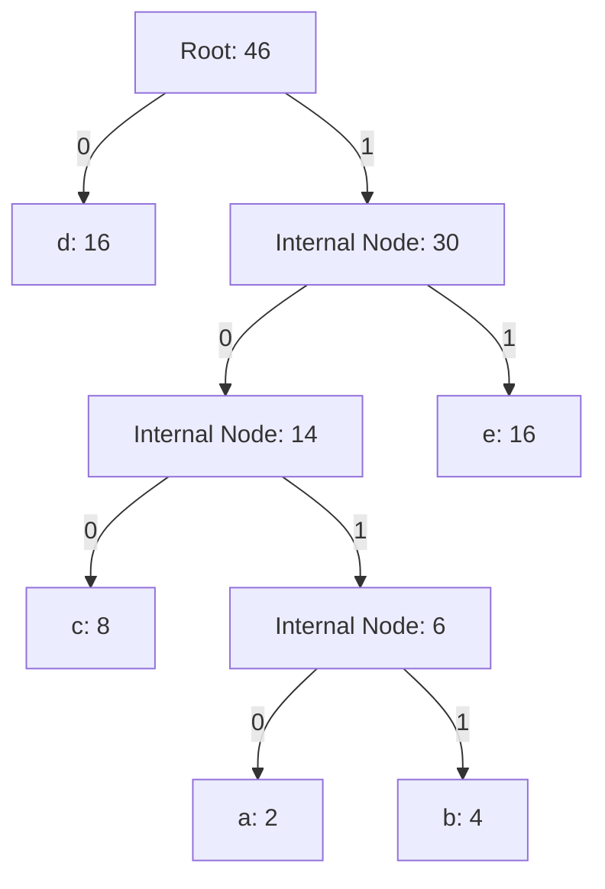

# PROBLEM 3: HUFFMAN CODING

## 3.1 Introduction

Huffman Coding is a lossless data compression algorithm used to reduce the number of bits required to represent data.

It works by assigning shorter binary codes to symbols that occur more frequently and longer binary codes to symbols that occur less frequently.

The algorithm uses a binary tree and a priority queue to generate efficient binary codes for different symbols.

In this project, Huffman Coding was implemented using Python based on the symbols and frequencies provided in the assignment.

## 3.2 Problem Objective

The objective of this problem is to implement the Huffman Coding algorithm using Python.

The program is required to:

1. Accept the given symbols and their frequencies.
2. Construct a Huffman binary tree.
3. Generate binary codes for each symbol.
4. Encode the original text using the generated codes.
5. Calculate the total length of the encoded file in bits.
6. Display the generated codes and encoded result.

## 3.3 Given Symbols and Frequencies

The assignment provides five symbols with the following frequencies:

| Symbol    | Frequency |
| --------- | --------: |
| a         |         2 |
| b         |         4 |
| c         |         8 |
| d         |        16 |
| e         |        16 |
| **Total** |    **46** |

The total frequency is 46, meaning that the original text contains 46 characters.

These frequencies are used as the input for constructing the Huffman tree.

## 3.4 Explanation of the Huffman Coding Algorithm

Huffman Coding works by repeatedly combining the two nodes with the smallest frequencies until only one node remains.

The following steps were used:

1. Each symbol was created as an individual node with its corresponding frequency.
2. All nodes were inserted into a priority queue.
3. The two nodes with the smallest frequencies were removed from the queue.
4. A new parent node was created using the sum of their frequencies.
5. The two removed nodes were connected as the left and right children of the new parent.
6. The new parent node was inserted back into the priority queue.
7. The process continued until only one node remained.

The final remaining node became the root of the Huffman tree.

Binary codes were generated by assigning 0 to every left branch and 1 to every right branch.

## 3.5 Huffman Tree Diagram

The Huffman tree was constructed by repeatedly combining the two nodes with the smallest frequencies.

The final tree represents all five symbols and their frequencies.



The left branches represent binary digit 0, while the right branches represent binary digit 1.

Each symbol's Huffman code is obtained by following the path from the root node to its corresponding leaf node.

```

```

## 3.6 Generated Huffman Codes

After constructing the Huffman tree, the program generated the following binary codes for each symbol.

| Symbol | Frequency | Huffman Code | Code Length |
| ------ | --------: | ------------ | ----------: |
| a      |         2 | 1000         |      4 bits |
| b      |         4 | 1001         |      4 bits |
| c      |         8 | 101          |      3 bits |
| d      |        16 | 0            |       1 bit |
| e      |        16 | 11           |      2 bits |

The codes were generated by following the paths from the root of the Huffman tree to each symbol.

Symbols with higher frequencies received shorter binary codes, while symbols with lower frequencies received longer binary codes.

## 3.8 Calculation of the Encoded File Length

The total encoded file length is calculated by multiplying the frequency of each symbol by the length of its assigned Huffman code.

The formula is:

**Total Encoded Length = Sum of (Frequency × Code Length)**

Using the generated Huffman codes:

| Symbol    | Frequency | Code Length |  Total Bits |
| --------- | --------: | ----------: | ----------: |
| a         |         2 |           4 |           8 |
| b         |         4 |           4 |          16 |
| c         |         8 |           3 |          24 |
| d         |        16 |           1 |          16 |
| e         |        16 |           2 |          32 |
| **Total** |    **46** |             | **96 bits** |

### Mathematical Calculation

Total Encoded Length:

= (2 × 4) + (4 × 4) + (8 × 3) + (16 × 1) + (16 × 2)

= 8 + 16 + 24 + 16 + 32

= **96 bits**

Therefore, the total encoded file length is 96 bits.

This result was confirmed by the Python program, which calculated the same encoded length.

## 3.9 Testing and Results

The Huffman Coding program was executed and tested using Python.

The test confirmed that the program successfully constructed the Huffman tree, generated binary codes, encoded the original text, and calculated the encoded file length.

### Testing Results

| Test No. | Test Description             | Expected Result                         | Status |
| -------- | ---------------------------- | --------------------------------------- | ------ |
| 1        | Load symbol frequencies      | Five symbols displayed correctly        | Passed |
| 2        | Build Huffman tree           | One complete Huffman tree created       | Passed |
| 3        | Generate binary codes        | A unique code generated for each symbol | Passed |
| 4        | Encode original text         | Original text converted into binary     | Passed |
| 5        | Calculate encoded length     | 96 bits                                 | Passed |
| 6        | Verify encoded string length | 96 bits                                 | Passed |

### Testing Observation

The program successfully generated the following codes:

- a = 1000
- b = 1001
- c = 101
- d = 0
- e = 11

The calculated encoded file length was 96 bits, which matched the actual length of the encoded binary string.

**Testing Conclusion:** The Huffman Coding implementation executed successfully and produced the expected results.

## 3.10 Time and Space Complexity

Time complexity describes how the execution time of an algorithm increases as the number of symbols increases. Space complexity describes the additional memory required by the algorithm.

Let **n** represent the number of unique symbols.

### A. Building the Huffman Tree

The algorithm uses a priority queue to repeatedly remove the two nodes with the smallest frequencies and insert their combined parent node.

- **Time Complexity:** O(n log n), because priority queue operations take logarithmic time and are performed repeatedly.
- **Space Complexity:** O(n), because the tree and priority queue store nodes.

### B. Generating Huffman Codes

The algorithm traverses the Huffman tree to generate a binary code for every symbol.

- **Time Complexity:** O(n), because each tree node is visited once.
- **Space Complexity:** O(n), for the generated codes and recursive traversal.

### Complexity Summary

| Operation                 | Time Complexity | Space Complexity |
| ------------------------- | --------------- | ---------------- |
| Building the Huffman Tree | O(n log n)      | O(n)             |
| Generating Huffman Codes  | O(n)            | O(n)             |

### Explanation

Huffman Coding efficiently compresses data by assigning shorter codes to frequently occurring symbols and longer codes to less frequent symbols.

The priority queue helps the algorithm efficiently select the two smallest frequencies during tree construction.

## 3.11 Conclusion

This project successfully demonstrated the implementation of the Huffman Coding algorithm using Python.

The program used the given symbol frequencies to construct a Huffman binary tree and generate variable-length binary codes for each symbol.

The generated codes were used to encode the original text, and the total encoded file length was calculated successfully.

The final encoded file length was **96 bits**, which was verified by both the mathematical calculation and the Python program.

Through this exercise, we gained a better understanding of data compression, binary trees, priority queues, recursion, and algorithm complexity.

**Final Result:** The Huffman Coding algorithm was successfully implemented and tested using Python, producing an encoded file length of 96 bits.
